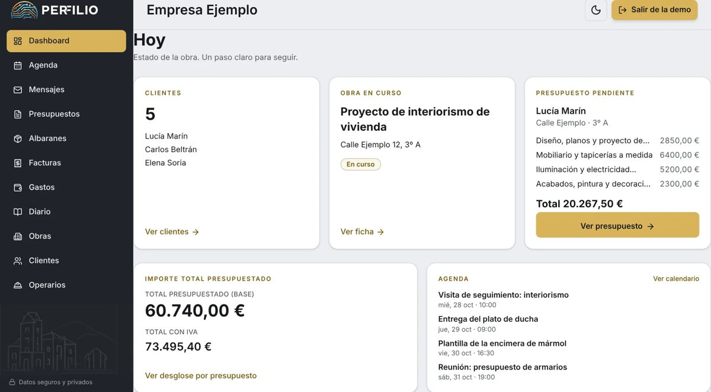

  <picture>
    <source media="(prefers-color-scheme: dark)" srcset="assets/cabecera-dark.svg">
    
  </picture>

Estudio **DAW** en Gipuzkoa y busco **prácticas o mi primer puesto junior full-stack**. Construyo aplicaciones web con agentes de IA que hacen cosas de verdad (no solo charlar) y me interesa la **seguridad web y de IA**: estoy preparando el **eJPT**.

---

## ⭐ Proyecto destacado: Perfilio

  

**El encargado que no duerme.** Asistente por voz para pymes de oficios (reformas, albañilería, pintura, fontanería, electricidad…) en Euskadi: dictas en obra y la app se encarga del papeleo.

- 🎙️ **Voz, foto o texto → documentos reales**: presupuestos con IVA en PDF, albaranes, facturas, gastos a partir de la foto del ticket y diario de obra.
- 🤖 **Agente de IA con herramientas**: clasifica la intención, ejecuta solo las herramientas de ese ámbito y pide confirmación antes de escribir datos. También se puede operar desde fuera con un servidor **MCP**.
- 🔐 **Multi-negocio con RLS** en Supabase: cada negocio solo ve sus datos. Facturación **TicketBAI** en preparación (las facturas ya se generan; falta cerrar la conexión con Hacienda).

**Cómo está comprobado:** más de 180 archivos de tests (Jest) y evals contra el modelo real para medir si el agente elige bien la herramienta.

  <picture>
    <source media="(prefers-color-scheme: dark)" srcset="assets/perfilio-panel-oscuro.jpg">
    
  </picture>

Panel «Hoy» con datos de ejemplo, en modo claro u oscuro según tu tema.

  <a href="https://perfilio.vercel.app"><b>Ver la web →</b></a>

---

## Proyectos

| Proyecto | Qué es | Stack |
|---|---|---|
| **[Perfilio](https://perfilio.vercel.app)** | Asistente por voz con agente de IA para pymes de oficios. Presupuestos, facturas y diario de obra dictados. | Next.js · Supabase · OpenAI · MCP · Vercel |
| **[Kore](https://github.com/adopico83/kore)** · [app](https://kore-ochre.vercel.app) | «El sistema operativo de tu hogar»: PWA familiar (agenda, compra, colegio, salud, recados). Un orquestador con 11 subagentes actúa por voz o texto sobre la base de datos del hogar. | Next.js · Supabase · OpenAI · Vitest · Web Push |

Kore tiene 128 tests con Vitest, RLS cerrado por familia y avisos push.

---

## Tecnologías

---

## Cómo trabajo

Dirijo agentes de IA para avanzar rápido, pero **el criterio es mío**:

- **Reviso cada PR.** Nada llega a producción sin pasar por una propuesta de cambio que leo.
- **Tests y evals.** Pruebas automáticas para lo que puede romperse y evals con el modelo real para el comportamiento del agente.
- **Seguridad desde el diseño.** Permisos por fila (RLS), confirmación antes de escribir y claves solo en servidor.
- **Lo dejo por escrito.** Decisiones y aprendizajes documentados en cada proyecto.

---

## Contacto

📫 **Email:** [adopico83@gmail.com](mailto:adopico83@gmail.com)
🌐 **Portfolio:** [portfolio-dopico.vercel.app](https://portfolio-dopico.vercel.app/es)
<!-- 💼 LinkedIn (opcional): añade aquí tu enlace si quieres -->
